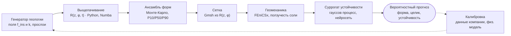
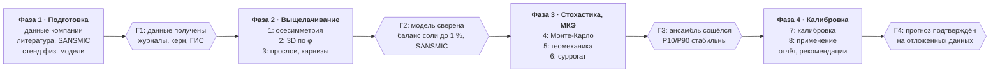

# Паспорт работы: модель скважинного выщелачивания NaCl

> Живой документ. Меняется подход — правим паспорт и записываем решение в
> [`decisions.md`](decisions.md). Текущее состояние работ — в [`progress.md`](progress.md),
> детальный план ПО — в [`software-plan.md`](software-plan.md).

## Цель, задачи и результаты

**Цель:** создать 3D-модель роста камеры при скважинном выщелачивании NaCl, которая даёт
не одну форму, а вероятностный прогноз формы и устойчивости с учётом неопределённости
геологии и режима.

**Задачи**

1. Детерминированная модель выщелачивания: стратификация рассола, анизотропное растворение,
   нерастворимые, нерастворитель, режим закачки.
2. Стохастический блок: коррелированные случайные поля свойств, прослои, обрушение карнизов,
   Монте-Карло по реализациям.
3. Геомеханическая оценка устойчивости камеры с учётом ползучести соли.
4. Калибровка по данным компании, физической модели и (при возможности) сонарным съёмкам.

**Ожидаемые результаты**

- Огибающие формы камеры P10/P50/P90: радиус по глубине и азимуту во времени.
- Вероятность нарушения целика, выхода кровли за допустимую отметку, асимметричного роста.
- Вероятностная оценка запаса устойчивости камеры.
- Рекомендации по режиму: расход, глубина башмаков колонн, уровень нерастворителя.

## Объект и физические процессы

Объект: одиночная камера (затем куст камер), создаваемая через скважину с концентрическими
колоннами в пласте каменной соли с прослоями ангидрита и глин.

| Процесс | Что даёт | Как учесть |
| --- | --- | --- |
| Плотностная стратификация рассола | Неравномерный рост по глубине | Баланс соли по слоям z, вертикальное перемешивание |
| Свободная конвекция у стенки | Скорость массопереноса слабо зависит от высоты | Sh ~ Ra^(1/3), калибровка коэффициента |
| Анизотропия растворения | Кровля быстрее стенок, подошва почти не растворяется | Коэффициент k(ψ) от угла наклона поверхности |
| Струя пресной воды из колонны | Зона интенсивного растворения у башмака | Плюмовая модель струи |
| Нерастворитель в кровле | Ограничивает рост вверх | Уровень как граничное условие по времени |
| Нерастворимые | Засыпают подошву, поднимают её | Осаждение с коэффициентом разрыхления |
| Прослои ангидрита и глин | Карнизы и их обрушение, скачки формы | Критический пролёт, вероятностное обрушение |
| Режим закачки (прямоток/противоток) | Распределение недонасыщения в камере | Сценарии режима, расход по времени |
| Ползучесть соли | Конвергенция, напряжения в кровле | Геомеханический блок |

За рамками первой версии: термические эффекты, геохимия примесей (K, Mg, сульфаты),
взаимодействие соседних камер.

## Математическая модель выщелачивания

Стенка камеры описывается радиальной функцией R(z, φ, t) на сетке «слои по глубине ×
секторы по азимуту» (порядка 200 × 36). Это и есть расчётные «квадранты», привязанные к
поверхности камеры, а не ко всему объёму. МКЭ здесь не нужен: хватает конечных объёмов и
явной схемы по времени.

Поток соли со стенки и скорость её отступания по нормали:

```math
j = k_0 \, f(\psi) \, C_s \, u^{n}, \qquad u = \frac{C_s - C}{C_s}, \qquad
V = \frac{j}{\rho_s (1 - f_{ins})}
```

Движение стенки как графика R(z) (уравнение Гамильтона–Якоби, схема Годунова):

```math
\frac{\partial R}{\partial t} = V \sqrt{1 + \left(\frac{\partial R}{\partial z}\right)^2}
```

Баланс соли в слое рассола z:

```math
\frac{\partial (V C)}{\partial t} = Q_{in} C_{in} - Q_{out} C_{out} + \dot m_{diss}(z)
+ \frac{\partial}{\partial z}\left(D_{eff} A \frac{\partial C}{\partial z}\right)
```

**Состав модели**

- Стратификация: одномерное по z поле концентрации, плотность рассола как функция C;
  неустойчивые слои перемешиваются.
- Струя: плюмовая модель от башмака колонны, распределяет пресную воду по слоям.
- Растворение: f(ψ) с максимумом для кровли и минимумом для подошвы; C_s — растворимость
  при пластовой температуре.
- Нерастворимые: высвобождаются пропорционально растворённому объёму, оседают на дно с
  коэффициентом разрыхления.
- Нерастворитель: верхняя граница растворения, уровень задаётся по времени.
- Карнизы: при пролёте нависающего прослоя больше критического он обрушивается и
  добавляется к нерастворимым.
- Шаг по времени: из условия устойчивости явной схемы и ограничений на рост объёма и
  пересыщение рассола.

Требование по скорости: один прогон за доли секунды – секунды, иначе Монте-Карло станет
неподъёмным.

## Стохастический блок (Монте-Карло)

Случайными делаются входные данные, а не сами события растворения: при известных условиях
растворение почти детерминировано. Ячейки не независимы, поэтому все поля генерируются с
пространственной корреляцией.

| Неопределённость | Распределение / генератор | Откуда параметры |
| --- | --- | --- |
| Положение и мощность прослоев | Нормальное/усечённое вокруг отметок по ГИС | Керн, ГИС, соседние скважины |
| Доля нерастворимых f_ins(z, φ) | Коррелированное гауссово поле (вариограмма) | Керн, лабораторные анализы |
| Множитель скорости k | Логнормальное коррелированное поле | Лабораторные тесты растворения |
| Обрушение карнизов | Вероятность растёт с пролётом | Литература, сонар, калибровка |
| Отклонения режима | Разброс расхода и уровня нерастворителя | Технологический регламент |

**Выходы по ансамблю**

- Огибающие P10/P50/P90 радиуса по глубине и азимуту.
- Вероятность нарушения целика между камерами.
- Вероятность выхода кровли выше допустимой отметки.
- Вероятность смещения центра камеры от оси скважины больше заданного.
- Распределение объёма камеры и времени достижения проектного объёма.

**Контроль сходимости:** число реализаций выбирается по стабилизации квантилей P10/P90
(ориентир — от 1000). Для дорогих расчётов — латинский гиперкуб или квази-Монте-Карло,
анализ чувствительности по индексам Соболя.

## Геомеханический блок

Геомеханика считается готовой библиотекой, свой МКЭ с нуля не пишется. Связь с
выщелачиванием в основном односторонняя: форма камеры → напряжения → критерии устойчивости.

- **Модель среды:** упругость + ползучесть соли (Munson–Dawson или Lubby2), покрывающие
  породы упругие или упругопластические.
- **Нагрузки:** горное давление по глубине, давление рассола в камере, этапы выщелачивания
  и эксплуатации.
- **Критерии:** растягивающие напряжения в кровле и стенках, критерий дилатансии, скорость
  и накопленная конвергенция объёма, минимально допустимое давление рассола, устойчивость
  целика.
- **Сетка:** строится автоматически из R(z, φ) через Gmsh.
- **Стратегия по ансамблю:** полный расчёт для нескольких сотен характерных форм, затем
  суррогат (гауссов процесс или нейросеть). Входы суррогата: максимальный пролёт кровли,
  отношение высоты к диаметру, толщина целика, глубина, давление рассола. Выход: запас
  устойчивости.
- **Обратная связь:** конвергенция за время выщелачивания обычно мала и учитывается
  периодической поправкой формы.

## Программная архитектура и инструменты

Ядро выщелачивания пишется самостоятельно — это научная новизна работы; геомеханика и
сетки берутся из готовых библиотек.



Пунктир — калибровка: прогноз сравнивается с данными компании, физической моделью и
сонаром (если будет), и по расхождению обновляются распределения параметров в генераторе
геологии.

| Модуль | Назначение | Инструменты |
| --- | --- | --- |
| `leaching/` | Стратификация, растворение, нерастворимые, карнизы | Python, NumPy, Numba |
| `stochastic/` | Случайные поля, прослои, Монте-Карло, статистика | NumPy, SciPy, gstools, joblib или Dask, SALib |
| `mesh/` | Сетка из R(z, φ) | Gmsh (Python API) |
| `mechanics/` | Ползучесть, напряжения, критерии | FEniCSx (альтернатива — MOOSE); проверка — FLAC3D, Abaqus или COMSOL |
| `surrogate/` | Суррогат запаса устойчивости | scikit-learn, GPyTorch или PyTorch |
| `calibration/` | Сравнение с данными, байесовское обновление | PyMC или emcee |

Свой МКЭ оправдан, только если это отдельная учебная или методическая цель; тогда начать с
осесимметричной задачи и сверять с FEniCSx.

## Исходные данные и калибровка

Главный источник калибровки — промысловые данные компании, дополненные физической моделью
и, при возможности, сонарными съёмками. Три источника в порядке надёжности:

1. **Данные компании** — журналы режима, концентрация рассола на выходе, керн, ГИС,
   объёмы добычи.
2. **Небольшая физическая модель** — растворение соли водой в лабораторном баке для k(ψ)
   и стратификации.
3. **Сонарные съёмки камер**, если компания их проведёт или предоставит.

До получения данных используются открытые источники: SANSMIC (Sandia, открытый код),
отчёты Sandia по камерам SPR с сонарными профилями, литература по скорости растворения
(Durie & Jessen; Cohen et al., 2020) и параметрам ползучести.

| Данные | Для чего | Источник |
| --- | --- | --- |
| Литологический разрез, отметки прослоев | Геометрия пласта, стохастика прослоев | Керн, ГИС |
| Доля нерастворимых по глубине | f_ins, осаждение на дно | Лабораторный анализ керна |
| Скорость растворения при разных углах | k(ψ) | Лабораторные тесты на образцах |
| Растворимость, плотность рассола от C и T | C_s, стратификация | Справочные данные, лаборатория |
| Режим: расход, концентрация на выходе, глубины колонн, уровень нерастворителя | Граничные условия, проверка баланса | Журналы промысла |
| Форма полости в физической модели во времени (фото, 3D-сканирование, датчики электропроводности для профиля C(z)) | Калибровка k(ψ), стратификации, нерастворимых | Лабораторная установка; опубликованные сонарные профили |
| Параметры ползучести соли | Геомеханика | Лабораторные испытания, литература |
| Напряжённое состояние массива | Геомеханика | Гидроразрыв, литература по району |

**Калибровка:** сначала априорные распределения k(ψ) и параметров стратификации по
физической модели; затем байесовское обновление по данным компании (баланс соли:
расход × концентрация на выходе даёт растворённый объём во времени, и модель обязана его
воспроизводить); при появлении сонара — по форме камеры. Перенос с физмодели на натуру —
через критерии подобия (Ra, Sh, Sc): в лаборатории Ra на порядки меньше натурного, поэтому
важно проверить, турбулентен ли пограничный слой у стенки, и не переносить коэффициенты
напрямую. Прослои, карнизы и геомеханику физическая модель не воспроизводит — их
параметры берутся из литературы как неопределённость.

**Бенчмарки:** открытая версия SANSMIC (Sandia) для осесимметричного случая и
опубликованные сонарные профили камер.

## Дорожная карта

Проект идёт четырьмя фазами; переход в следующую фазу — только после прохождения ворот.
Стенд физической модели и запрос данных у компании стартуют сразу, потому что опыты и
согласования идут параллельно с разработкой кода.



Если ворота не пройдены, фаза повторяется с уточнёнными параметрами, а не переносится
ошибка дальше. Сроки фаз пока не заданы.

- [ ] Определить дату старта и общий срок проекта
- [ ] Согласовать с компанией перечень данных и сроки их передачи

## Этапы работ и контрольные точки

Каждый этап заканчивается проверяемым результатом; следующий начинается только после него.
Ход работ по этапам — в [`progress.md`](progress.md).

- [ ] **1. Осесимметричная модель выщелачивания.** Стратификация, k(ψ), нерастворимые,
  нерастворитель, струя. Контроль: совпадение с SANSMIC или опубликованным сонарным
  профилем, баланс массы соли с ошибкой < 1 %.
- [ ] **2. Азимутальное измерение (3D).** R(z, φ, t), неоднородность по азимуту.
  Контроль: при однородных свойствах результат совпадает с этапом 1.
- [ ] **3. Прослои и карнизы.** Критический пролёт, обрушение, добавление к нерастворимым.
  Контроль: качественное воспроизведение ступенчатых профилей по сонару.
- [ ] **4. Стохастический блок.** Генерация полей, Монте-Карло, параллельный запуск,
  статистика. Контроль: сходимость квантилей P10/P90, анализ чувствительности.
- [ ] **5. Геомеханика.** FEniCSx + закон ползучести, сетка из Gmsh. Контроль: сравнение
  с аналитическим решением для цилиндрической и сферической полости и с коммерческим
  пакетом на одной задаче.
- [ ] **6. Суррогат устойчивости.** Обучение на сотнях форм. Контроль: ошибка на
  отложенной выборке в пределах заданного допуска.
- [ ] **7. Калибровка и валидация.** Калибровка на данных компании по одной части камер
  или периоду, проверка прогноза объёма и концентрации на остальных; физическая модель —
  для k(ψ) и стратификации; сонар — для проверки формы, если будет.
- [ ] **8. Применение.** Карты вероятностей, сравнение режимов, рекомендации по
  технологии.

## Риски, допущения и верификация

**Допущения первой версии**

- Рассол в каждом слое по глубине перемешан по горизонтали.
- Растворение лимитировано массопереносом, кинетикой на поверхности пренебрегаем.
- Температура постоянна.
- Связь выщелачивания и геомеханики односторонняя.
- Одна камера, без влияния соседних.

| Риск | Последствие | Что делаем |
| --- | --- | --- |
| Данные компании неполные или без сонара | Прогноз только качественный | Калибровка по балансу соли из журналов промысла, физическая модель с подобием по Ra и Sh, запрос сонара хотя бы по одной камере |
| Неверный k(ψ) | Систематически неправильная форма | Лабораторные тесты, калибровка, анализ чувствительности |
| Модель карнизов слишком грубая | Недооценка разброса формы | Сравнение с сонаром, вариация критического пролёта |
| Монте-Карло слишком медленный | Мало реализаций, ненадёжные хвосты | Numba, параллелизация, квази-Монте-Карло, суррогаты |
| Ошибка суррогата в хвостах распределения | Недооценка риска потери устойчивости | Дообучение на крайних реализациях, полный расчёт для худших |
| Параметры ползучести неизвестны для данной соли | Неверная конвергенция | Диапазон по литературе, учёт как неопределённости |

**Верификация:** баланс массы, аналитические решения для простых геометрий, сравнение с
SANSMIC и коммерческим пакетом, валидация на данных компании и опытах физической модели,
не участвовавших в калибровке, при наличии — по сонару.
