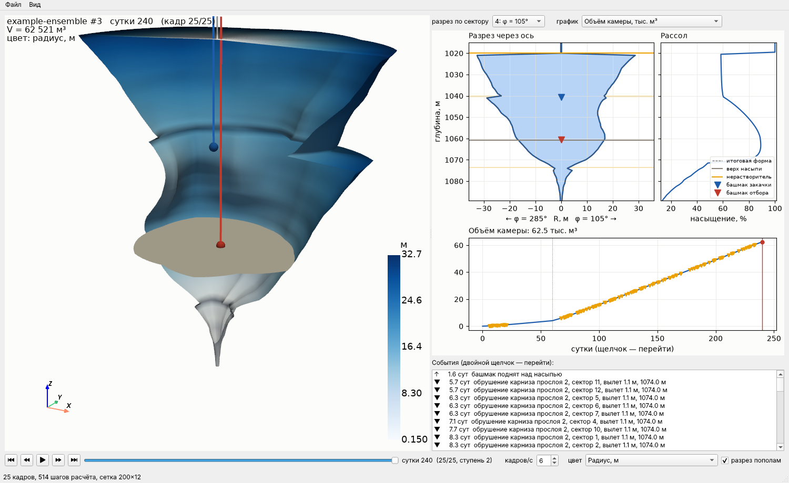
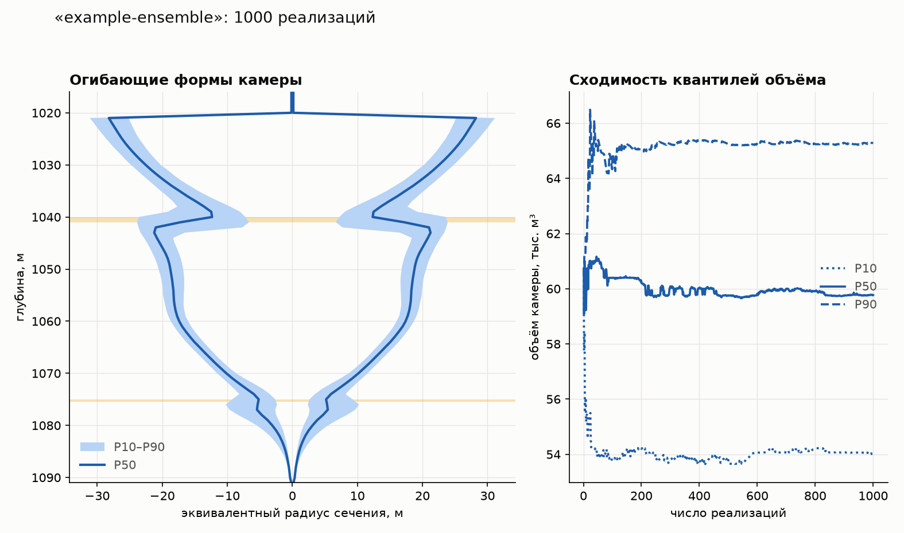
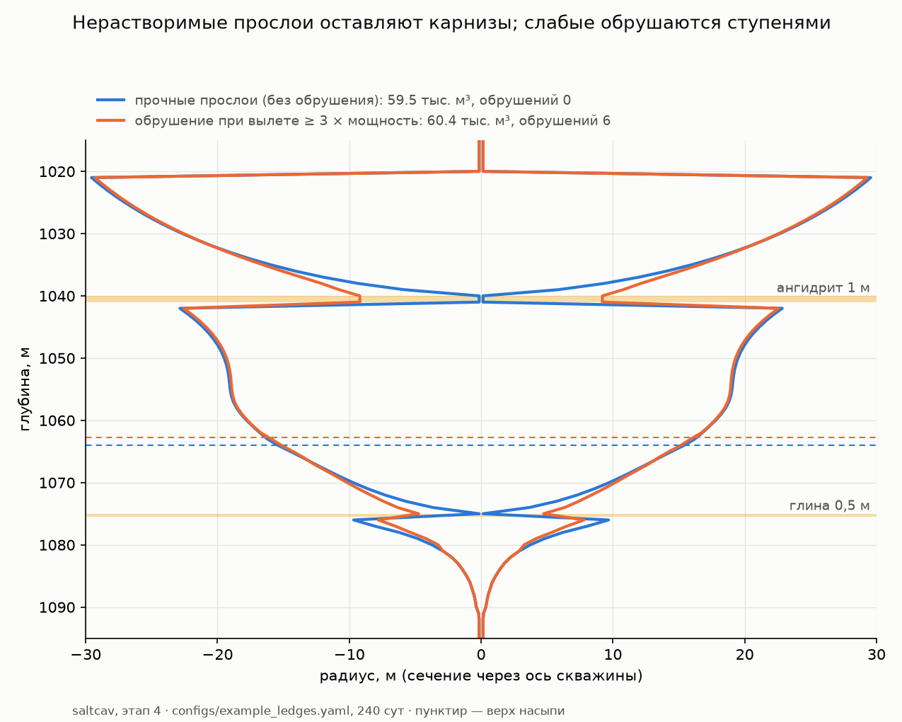
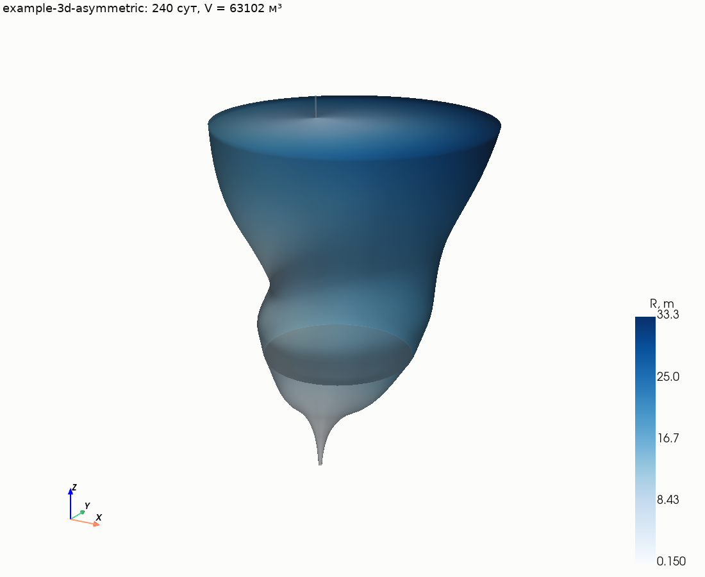
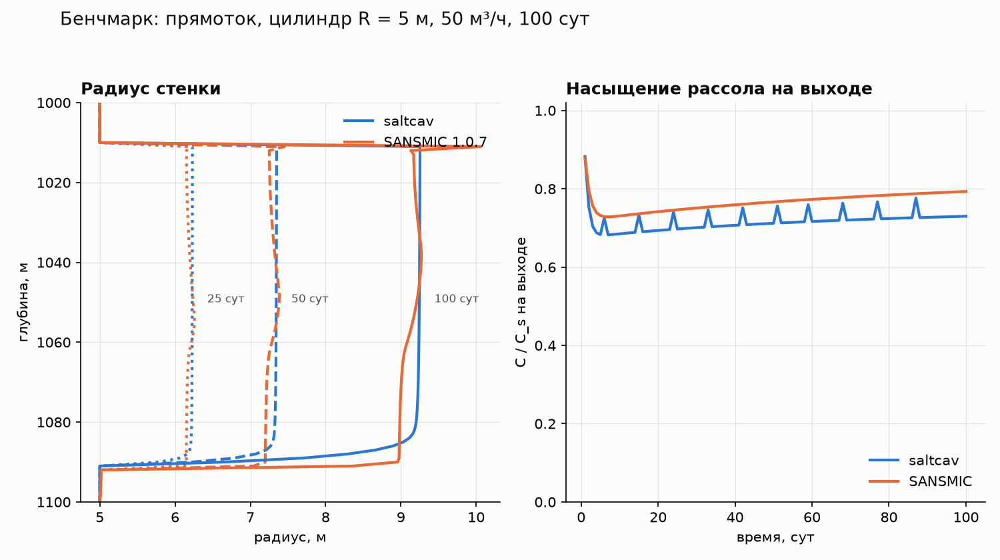
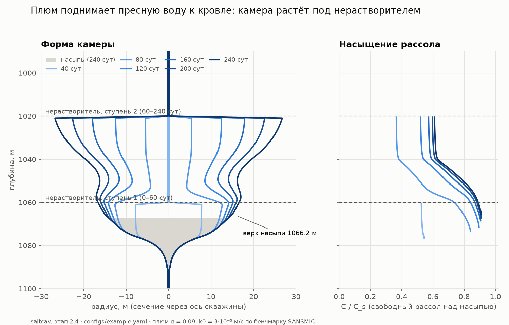
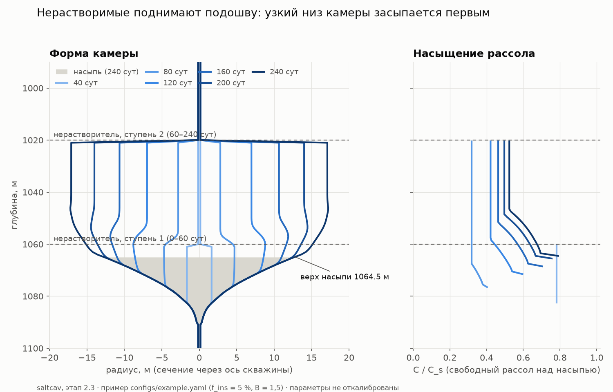
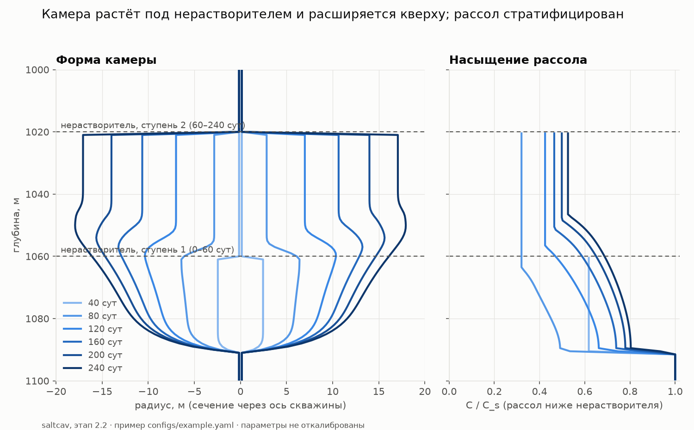

# Прогресс и заметки

Журнал хода работ: что сделано, что в работе, что дальше, и заметки, которые не являются
решениями. Решения с обоснованием — в [`decisions.md`](decisions.md); цели и план — в
[`passport.md`](passport.md) и [`software-plan.md`](software-plan.md).

Новые записи добавляются сверху.

## Текущее состояние

| | |
| --- | --- |
| **Фаза дорожной карты** | 3: стохастика готова (ворота Г3 — квантили сходятся); далее геомеханика |
| **Этап ПО** | 5 (стохастика и ансамбли) готов; далее 6 — сетка и геомеханика |
| **Тесты** | 173, CI зелёный на Python 3.11–3.13 |
| **Просмотр** | окно `saltcav view` по шагам (как Results Viewer в ANSYS), GIF/MP4, ParaView |
| **Ансамбль** | 1000 реализаций (12 секторов) — 4,2 мин на 2 ядрах; дрейф квантилей 0,4 % |
| **3D** | 36 секторов — 0,6 с; однородное 3D = осесимметрия до 1e-13 м |
| **Скорость прогона** | 240 сут, 200 слоёв, с плюмом — 0,3 с (цель ≤ 1 с) |
| **Пример** | 63 тыс. м³, R_max 27 м под нерастворителем, подошва 1066 м |
| **SANSMIC** | объём ±1 %, радиус ±1 %, насыщение на выходе 0,72 против 0,77 |
| **Данные компании** | не получены — работаем на открытых данных и синтетике |

### Дальше

1. **Этап 6 — сетка и геомеханика:** R(z, φ) → сетка Gmsh, ползучесть соли
   (Munson–Dawson), критерии устойчивости. Сначала посмотреть SafeInCave (TU Delft).
2. Сообщить разработчикам SANSMIC об ошибке метрического режима (текст issue готовится).
3. Пример конфигурации: добавить ступень размыва зумпфа и подъём колонн, чтобы башмак не
   оказывался в насыпи (сейчас модель поднимает его сама).
3. Вне кода: запрос данных в компанию, список литературы, схема стенда физической модели.

### Открытые вопросы

- Разбросы в `example_ensemble.yaml` (σ ln k = 0,3, длины корреляции 10 м и 60°,
  k0 ± 20 % и т. д.) — иллюстративные; нужны данные керна, ГИС и физмодели.
- Критический вылет карниза (сейчас 3 × мощность) — нужны данные: литература по
  карнизам ангидрита и глины, сонар компании; на этапе 5 — как неопределённость.
- Профиль у нас ровнее, чем у SANSMIC (там слабая стратификация и раструб под
  нерастворителем) — вертикальная турбулентная диффузия? узел на уровне нерастворителя?
- Зубцы насыщения на выходе при погребении слоя целиком — сделать вытеснение плавным.
- Вязкость рассола — какую корреляцию взять (нужна для Ra, Sc).
- Значения k0, n, roof_ratio по умолчанию — оценка, ждут калибровки.
- Коэффициент разрыхления B и доля нерастворимых — из керна компании; сейчас 1,5 и 5 %.
- Погребение слоя целиком по середине слоя — точность уровня подошвы порядка Δz.
- Дата старта и общий срок проекта не заданы.
- Перечень и сроки передачи данных компании не согласованы.

---

## Журнал

### 2026-10-24 — Подсказки для YAML в редакторе

- `saltcav schema` → `schema/saltcav-config.schema.json`; описания у всех полей; примеры в
  `configs/` ссылаются на схему (`# $schema:`). PyCharm: автодополнение, подсказки,
  проверка до запуска. Препроцессор в окне — после этапа 6.

### 2026-10-24 — Просмотрщик результатов по шагам (PR #13)

- Окно `saltcav view hist.npz` (PySide6-Essentials + pyvistaqt, `pip install -e ".[gui]"`, ≈ 85 МБ):
  ползунок моментов и воспроизведение, раскраска стенки (радиус, скорость растворения,
  отступ, недонасыщение, свойства породы), разрез пополам, разрез через ось по сектору,
  профиль насыщения, график по времени (щелчок — переход), журнал событий (обрушения,
  подъёмы башмака, ступени; двойной щелчок — переход). Клавиши ← → Home End, пробел.
- Без окна: `--screenshot`, `--animation a.gif|a.mp4`, `--paraview series.pvd`, `--field`.
- Файл результатов, формат 2 (`io/results.py`): всё для просмотра + конфигурация;
  история прогона пишет скорость стенки, башмаки, нерастворитель, ступень, концентрацию
  на выходе, моменты подъёма башмака.
- `run`/`view --realization N -n … --seed …` — пересчёт реализации ансамбля с полной
  историей; `ensemble` печатает номера реализаций с наибольшим радиусом и объёмом.
  `--every N` — частота записи.
- 

### 2026-10-24 — Этап 5: стохастика и ансамбли (PR #12) — ворота Г3

- Поля ln k и f_ins по узлам (z, φ): гауссовы, разделимая экспоненциальная ковариация,
  периодичность по азимуту без шва (`stochastic/fields.py`).
- Неопределённость скаляров: k0, кровля/стенка, критический вылет карниза, расход по
  ступеням, отметка и мощность прослоев; планы MC / LHS / Соболь (`stochastic/sampling.py`).
- Ансамбль (`stochastic/ensemble.py`): параллельно, бит в бит воспроизводимо; квантили
  формы, вероятности превышения, сходимость, чувствительность (Спирмен), .npz.
- `saltcav ensemble CONFIG -n N --jobs 0 [--radius-limit R] [--out] [--plot]`.
- Пример `configs/example_ensemble.yaml`, 1000 реализаций за 4,2 мин:
  объём P10/P50/P90 = 54,0 / 59,8 / 65,3 тыс. м³; макс. радиус 31 / 35 / 39 м;
  подошва 1061 / 1063 / 1066 м; смещение центра 3,3 / 5,2 / 7,7 м;
  P(макс. радиус > 35 м) = 0,50.

**Заметки:**
- Неопределённость формы сосредоточена на прослоях (отметка, мощность, момент
  обрушения карниза); между ними коридор P10–P90 узкий.
- Объём определяют k0 (Спирмен +0,74) и расход второй ступени (+0,50); подошва — критический
  вылет и мощность ангидрита (обломки карнизов). Значит, для прогноза объёма важнее всего
  калибровка закона растворения, а для подошвы — свойства прослоев.
- Даже без систематической асимметрии случайное поле по азимуту даёт смещение центра
  камеры 3–8 м — существенно для оценки целиков между камерами.
- Квантили объёма устанавливаются после ~200 реализаций; для хвостов (P1, P99) нужно больше.
- «Обрушения» считаются по секторам: одно обрушение карниза по кругу = 12 событий.

### 2026-10-24 — Этап 4: прослои и карнизы (PR #11)

- Ангидрит и глина не растворяются (множитель скорости 0 в узлах прослоя); соль над и
  под ними уходит, прослой остаётся карнизом.
- Вылет карниза L = min(R_над, R_под) − R_прослоя; при L ≥ L_крит (по умолчанию
  3 × мощность или `critical_span_m`) карниз в секторе обрушивается, обломки — в насыпь.
- Прослой-кровля (камера только снизу) не обрушивается: плита лежит на соли.
- Место обрушенного карниза заполняет рассол слоя; баланс: растворено + заполнение =
  прирост в камере + вынесено (точно).
- Пример `configs/example_ledges.yaml`: без обрушения — 22-метровый карниз ангидрита
  (физически невозможно); с обрушением — 6 обрушений ступенями, подошва выше на 1 м.

**Заметки:**
- Камера обходит прослой-кровлю через ствол скважины: ствол открыт сквозь прослой,
  соль над ним размывается — карниз становится двусторонним.
- Над прочным прослоем камера уже, чем под ним: верх подпитывается только через ствол.
- Критерий обрушения — простой (вылет/мощность); механика плиты (изгиб, прочность
  ангидрита) — кандидат на уточнение по литературе.

### 2026-10-24 — Этап 3: 3D по азимуту и 3D-просмотр (PR #10)

- Свойства стенки в узлах (z, φ): множитель скорости растворения и доля нерастворимых
  (`leaching/properties.py`); соль и нерастворимые считаются по секторам.
- Конфигурация: косинусная неоднородность по азимуту `k_variation`,
  `k_variation_azimuth_deg` (для проверки; случайные поля — этап 5).
- `saltcav view CONFIG|history.npz [--day] [--screenshot] [--vtk]` — 3D-вид в окне,
  картинка или поверхность для ParaView (нужен `pip install -e ".[viz]"`).
- Однородное 3D совпадает с осесимметрией до 1e-13 м; 36 секторов — 0,6 с (цель ≤ 10 с).
- Пример `configs/example_3d.yaml` (±30 % по направлению 45°): радиус на 1045 м
  23,6 м против 11,5 м с противоположной стороны, центр сечения смещён на 6,9 м.

**Заметки:**
- Секторы растворяются независимо, связь по азимуту — только через общую концентрацию
  слоя (рассол в слое перемешан по горизонтали). Сглаживание между секторами не
  понадобилось: схема устойчива по каждому сектору отдельно.
- ±30 % по скорости дают почти двукратную разницу радиусов — неоднородность усиливается,
  так что стохастика по азимуту (этап 5) существенна для прогноза асимметрии.
- Шрифт VTK без кириллицы — подписи рисуются шрифтом DejaVu из matplotlib.

### 2026-10-24 — Этап 2.4: струя, плюм, сверка с SANSMIC (PR #8) — ворота Г2

- Струя из башмака вниз, разворот, плюм вверх с вовлечением (МТТ, α = 0,09); отдача на
  уровне нейтральной плавучести; неявный консервативный перенос с обратным течением.
- Бенчмарк против SANSMIC 1.0.7 (`benchmarks/sansmic/`): прямоток в цилиндре R = 5 м,
  100 сут. Эталон в git, сверка в CI.
- k0 = 3·10⁻⁵ м/с по бенчмарку: объём ±1 %, радиус ±1 %.
- Таблица плотности рассола совпала с таблицей SANSMIC (CRC) — открытый вопрос закрыт.

**Заметки:**
- В точке разворота струи уравнение для M вырождается; переход на M² убрал
  «взрыв» вовлечения до сотен м³/с.
- С обратным течением прирост объёма слоя заполняется рассолом соседей — проверка
  пересыщения должна идти по V_old, иначе C > C_s.
- **Метрический режим SANSMIC 1.0.7 ошибочен:** объём делится на 5,615, радиус растёт
  в ~3,3 раза быстрее возможного. Нашли по нарушению баланса соли; в ft/bbl всё верно.
- С плюмом пресная вода всплывает к кровле: максимум радиуса под нерастворителем,
  форма классическая (купол сверху, сужение книзу).

### 2026-10-24 — Этап 2.3: нерастворимые и подъём подошвы (PR #6)

- Твёрдая доля f_ins растворённой породы оседает насыпью с коэффициентом разрыхления B;
  уровень подошвы — по объёму камеры снизу.
- Погребённые слои выходят из колонны рассола: доля 1/B рассола вытесняется к отбору,
  остальное остаётся в порах. Стенка под насыпью не растворяется.
- Башмак в насыпи переносится на слой над ней (как подъём колонны); считается в истории.
- `saltcav run` показывает уровень подошвы и объём насыпи.
- Пример: насыпь ≈ 3,1 тыс. м³ подняла подошву с 1100 до 1064,5 м; объём камеры
  ≈ 41 тыс. м³ вместо 51 тыс. (низ засыпан и не растворяется).

**Заметки:**
- 35 м подъёма при 3 тыс. м³ насыпи — геометрия, а не ошибка: низ камеры узкий, почти
  конус, а у конуса нижние 7,5 % объёма (столько занимает насыпь при f = 5 %, B = 1,5) —
  это ≈ 42 % высоты. Отсюда практика размыва зумпфа до основного выщелачивания.
- Башмак закачки на 1090 м уходит в насыпь уже на первой ступени — в примере режима
  надо поднимать колонну или начинать с размыва зумпфа.
- Рассол в порах насыпи хранит концентрацию на момент погребения и в проверке
  плотностной устойчивости не участвует — это не свободная жидкость.

### 2026-10-24 — Этап 2.2: растворение стенки, первый рост камеры (PR #4)

- Закон растворения j = k0·f(ψ)·C_s·u^n, анизотропия кровля/стенка/подошва.
- Движение стенки по уравнению Гамильтона–Якоби, численный гамильтониан Годунова.
- Связанный прогон стенка + рассол с адаптивным шагом; команда `saltcav run`.
- Пример (240 сут): объём ≈ 51 тыс. м³, R_max ≈ 18 м под нерастворителем, растворено
  ≈ 105 тыс. т соли. Форма классическая: расширение кверху, узкая подошва, насыщенный
  рассол в зумпфе.

**Заметки — что нашли тесты:**
- Выбор «против потока» по знаку наклона неверен при разной скорости кровли и подошвы:
  кровля уходила на 9 м дальше аналитики. Нужен гамильтониан Годунова.
- Пустой узел (R = 0) не должен растворять «свою» стенку: иначе полюс сферы двигался со
  скоростью численного шага, ошибка росла при измельчении сетки.
- Узел на границе насыщенного и пресного слоя должен брать концентрацию насыщенного —
  иначе рассол пересыщался (C > C_s).
- Рассол не должен перемешиваться в ствол выше нерастворителя.

### 2026-10-24 — CI: mypy на Python 3.11 (PR #3)

- На 3.11 ставится более старая NumPy с другими аннотациями; mypy находил неточные типы.
  Тесты при этом проходили. Исправлено, CI зелёный на 3.11–3.13.
- **Заметка:** проверять типы локально на минимальной поддерживаемой версии Python
  (окружение 3.11 через `uv`).

### 2026-10-24 — Этап 2.1: график режима и баланс соли в рассоле (PR #2)

- Ступени режима в СИ, индексы слоёв башмаков и нерастворителя.
- Неявный перенос от закачки к отбору, отбор Q_out = Q_in − ΔV/dt, плотностное
  перемешивание (PAV). Соль сохраняется до округления.

**Заметка:** при потоке вверх верхние слои пути концентрируются (приходит плотный рассол
снизу), а не разбавляются — это верная физика, первоначальное ожидание теста было неверным.

### 2026-10-24 — Этап 1: свойства рассола и геометрия (PR #1)

- Плотность воды и рассола, растворимость NaCl (таблицы CRC), C_s ≈ 317 кг/м³ при 20 °C.
- Геометрия R(z, φ): фрустумы по z, секторы по φ; угол ψ (0° кровля, 90° стенка,
  180° подошва). Сфера < 0,1 % на 200 слоях, второй порядок сходимости.

**Заметка:** таблицы CRC внесены по справочным значениям — сверить с первоисточником.

### 2026-10-24 — Этап 0: инфраструктура

- Репозиторий `kizred/saltcav` (приватный), пакет, YAML-конфигурация, CI, pre-commit.
- Работа идёт через pull request на каждую часть; `main` всегда зелёный.

### 2026-10-23 — Постановка

- Выбран сценарий скважинного (управляемого) выщелачивания.
- Монте-Карло — по неопределённости входных данных, а не по событиям растворения.
- Источники калибровки: данные компании → физическая модель → сонар (при возможности).
- Составлены паспорт работы, дорожная карта и план разработки ПО.

---

## Как вести этот файл

- После каждого слитого PR — запись в журнал: дата, что сделано, ссылка на PR, заметки.
- Обновлять блок «Текущее состояние» и «Дальше».
- Заметки — наблюдения, сюрпризы, что нашли тесты, идеи на потом. Если заметка
  превращается в решение, переносить её в `decisions.md`.
